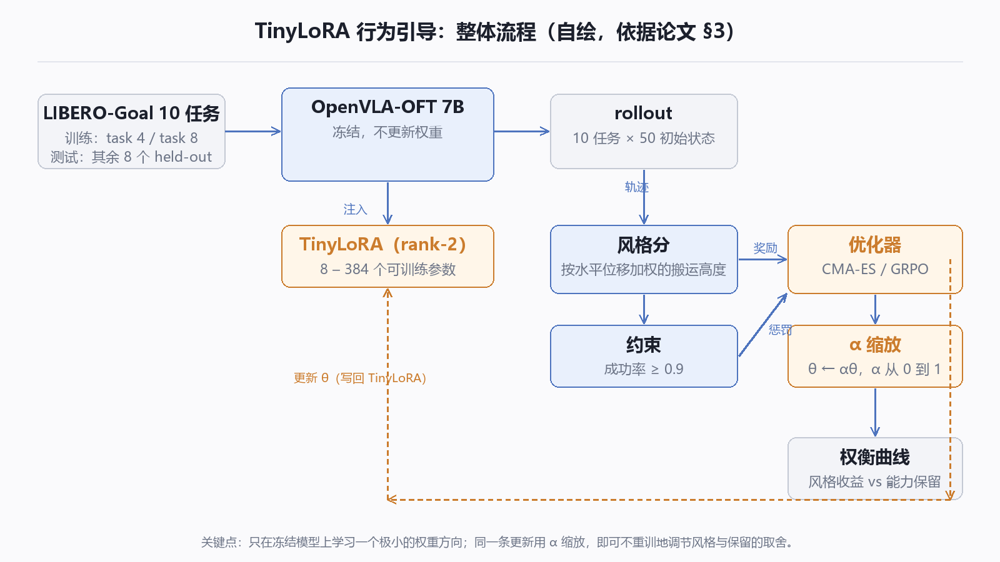
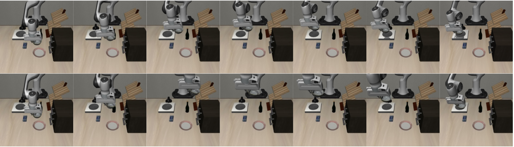
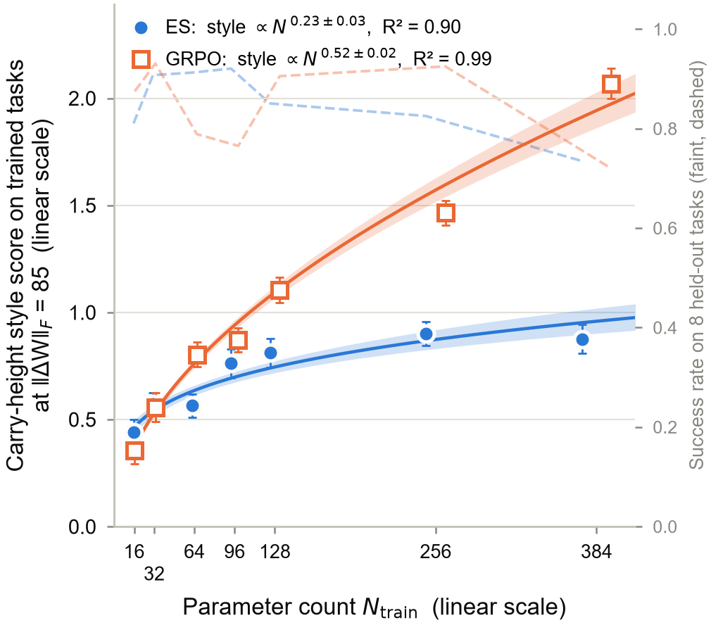
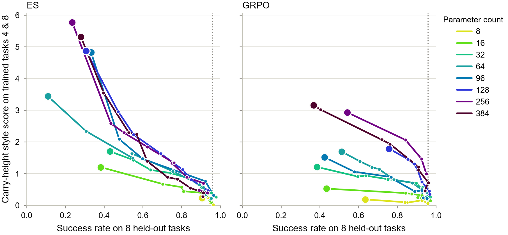

**一句话：** 把 70 亿参数的 VLA 完全冻住，只训练 256 个参数，就能把它「搬东西时举多高」这种执行风格调过来——训练过的任务抬高 120 mm、成功率 92%，没见过的任务抬高 74 mm、成功率 80%。

论文：[Behavioral Steering of Vision-Language-Action Models in the Low-Parameter Regime](https://arxiv.org/abs/2611.00522)（arXiv:2611.00522），James Tcheng、Feiyu Gavin Zhu，CMU，NeurIPS 2026 RoboPAD Workshop。

## 它想解决的问题

机器人的「本事」和「习惯」经常绑在一起。举高一点能避开台面边缘、减少碰撞，这对成功率影响很大，但它不是「会不会搬」的问题，是「怎么搬」的问题。

麻烦在于，改习惯的传统办法是全量微调或者重新训练——**而这会把原来的本事一起改坏**。你只想让它举得高一点，结果它连抓取策略都忘了。

之前也有人试过不改权重：在推理时干预激活值（activation steering），把某些神经元的激活钳到固定值。但论文指出两个问题：这些方向是照着「概念词」选的，不是照着目标行为优化的，所以**风格不一定变、成功率不一定保**；而且有研究发现，哪怕只改一个稀疏自编码器特征，也可能明显拉低任务成功率。

所以真正要问的是：**改行为，最少需要动多少参数？动完之后，原来的能力还能留下多少？**

## 方法

### 骨架：TinyLoRA

基座是 OpenVLA-OFT 7B（Llama-2 语言主干，32 层），这个 checkpoint 已经在 130 个 LIBERO 任务上做过 SFT + GRPO。

在上面挂 TinyLoRA：对冻结权重做 rank-2 的截断 SVD，固定左右奇异向量，只学习中间那点系数，再用固定随机投影把参数压到极低。通过「平铺共享」（三个投影共用一组向量、每 2 或 4 层再共享），可训练参数从 **8 个到 384 个**。

参数量公式是 N_train = u × ⌈nm / n_tie⌉，其中 u 是每组的系数个数。θ = 0 就退化成原始冻结策略——这一点很重要，意味着更新是从「原样」出发的一小步。

### 目标：把「举多高」写成一个奖励

风格分不是简单取平均高度，而是按**水平位移加权**的平均末端高度：只在真正搬着东西走的那段时间算，站着不动、只上下动、故意放慢都不算数——这是在防奖励作弊。

然后把它标准化（减去冻结策略的中位数、除以 95/5 分位差），得到风格分；约束是**成功率不低于 0.9**。也就是说，目标是「在别掉成功率的前提下，尽量举高」。

### 两个优化器

CMA-ES：无梯度进化搜索，每一代从高斯分布采样一批候选，只用整条轨迹的标量分数，看不到哪个动作起了作用。

GRPO：策略梯度，能看到每个动作的 log-prob，用组内归一化的优势来分配功劳。

两个优化器都在同一套 TinyLoRA 参数上搜，超参不同（CMA-ES 种群 24、每候选每任务 5 条 rollout、128–256 代；GRPO 150–200 次迭代、每次 8 组 × 8 条 rollout）。

### 一个不用重训的调节旋钮

这是我觉得最实用的一步：把学到的参数整体乘一个系数 α，从 0（原始策略）到 1（完整训练过的更新），就能连续地在「风格收益」和「能力保留」之间滑动。

因为 TinyLoRA 的权重更新对参数是线性的，缩放 θ 等价于缩放权重更新 ΔW，所以不用重训就能画出整条权衡曲线。

## 实验怎么做的

- **任务**：LIBERO-Goal 的 10 个桌面操作任务，物件和场景布局相同、目标不同；
- **训练**：只在 task 4（把碗放到柜子上）和 task 8（把碗放到盘子上）上训练；
- **测试**：剩下 8 个任务全留着当 held-out，专门测「能力有没有被弄丢」；另外用 held-out 的 task 1（把碗放到炉子上）测「风格能不能迁移」；
- **评测**：每个更新都跑完整套 10 个任务 × 50 个初始状态；
- **基线**：① 在指令前加 "high" 的 prompting；② 把 20 个「向上」相关神经元的激活钳到 10 或 20 的激活干预。

## 结果

**先看定性：确实举高了。**

这是论文 Figure 1，任务是从没训练过的「把碗放到炉子上」。上行是原始冻结策略，下行是**只用了 64 个参数**的更新。看得出来，下行把碗端得更高，避开了台面。

论文给出的数字是峰值高度 +188 mm。这比摘要里的 74 mm 大得多，因为摘要报的是「平均搬运高度」，图里报的是「峰值」——这两个数不是一回事，混着看容易误解。

**定量上，参数越多、风格越强。**

在固定权重更新幅度（‖ΔW‖_F = 85）的前提下，风格分随参数量按幂律增长：**ES 约 N^0.23，GRPO 约 N^0.52**（拟合 R² 分别是 0.90 和 0.99）。

图中虚线是 8 个 held-out 任务的成功率。可以看到 GRPO（橙）在参数变多之后，同样的参数量能换到更高的风格分——这也是为什么论文说「容量越大，GRPO 的性价比越好」。

**权衡曲线上，GRPO 更划算。**

这张图是全文信息量最大的。横轴是「没见过的 8 个任务上的成功率」，纵轴是「训练任务上的风格分」，每条线是一个参数量下扫描 α 得到的轨迹。

读法是：**同样保住 0.8 的 held-out 成功率，谁的风格分更高，谁更划算。** 右边 GRPO 那组曲线整体在左侧 ES 之上，而且参数量越大越靠右上。

**和两个基线比。**

论文的说法是：prompting 和 activation steering 在这套任务上**没有稳定地抬高举高**，激活干预还可能破坏任务成功率。这是它主张「需要学一个权重空间方向」的主要依据。

## 我的判断

**可信度：比较高。** 这篇的控制变量做得比多数 VLA 论文细：

1. 所有比较都固定了权重更新的 Frobenius 范数，把「方向」和「幅度」分开；
2. 比较不同更新时用的是**匹配 held-out 成功率**，而不是各自最好看的点；
3. 参数量的效应和训练预算分开讨论了（否则容易把「训得久」误当成「参数多」）。

**可迁移的启发：风格是低维的，能力是高维的。** 这条如果站得住，「个性化一个机器人」会比想象的便宜——几百个参数就能调出「轻拿轻放」「举高避障」这类偏好，真正贵的是别把它调笨。

**保留意见，三条：**

1. **只验证了一个风格轴。** 举高是能用标量描述、且与任务目标基本正交的偏好；换成「既轻又稳」「先快后慢」这种互相纠缠的要求，几百个参数还够不够，论文没有反例；
2. **没有稳定性指标。** 报的是平均/峰值高度和成功率，没有高度方差、没有碰撞次数。举过头顶有时候比举不够更糟，这部分空着；
3. **全在仿真里。** LIBERO-Goal 是理想化的桌面场景，物体和布局固定；真机上的接触、打滑、传感器噪声都没进来。

另外提醒一句：图里那个 +188 mm 和摘要里的 74 mm 不是一个量（峰值 vs 平均），引用时别混。

—— Aria
