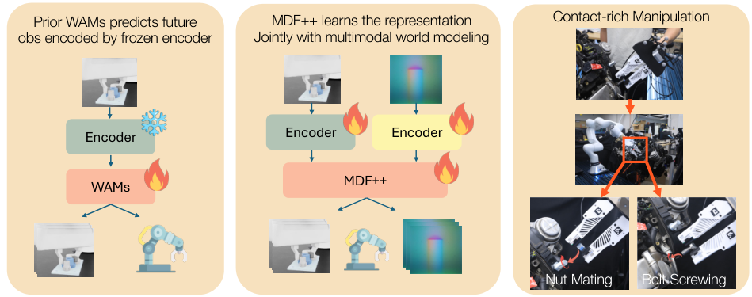
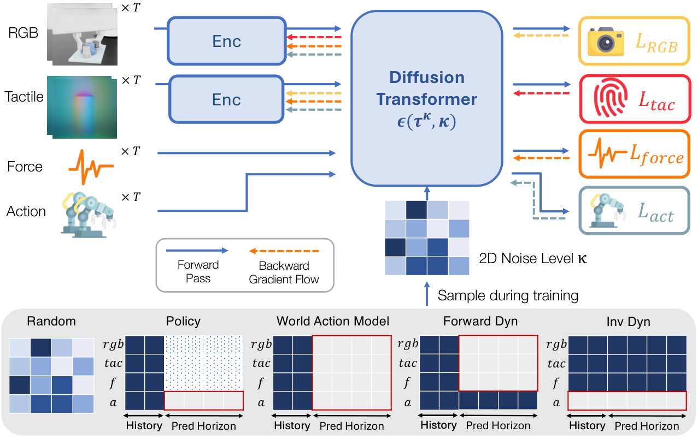

**一句话：** 把视觉和触觉的编码器与世界-动作模型（WAM）放在一起端到端训练，在螺母对拧、螺栓旋入这类接触密集任务上，成功率比沿用冻结预训练编码器的 WAM 高**最多 50%**。

论文：[MDF++: Visuo-Tactile World Action Model with End-to-end Representation Learning](https://arxiv.org/abs/2611.09293)（arXiv:2611.09293），Zixuan Huang 等，密歇根大学，**CoRL 2026**。

## 它想解决的问题

世界-动作模型（WAM）这两年很热：同时预测「动作」和「未来观测」，让机器人既会做、也能预判做的后果。但绝大多数 WAM 有个共同的偷懒——**编码器是冻结的**，直接拿来用 CLIP、DINO 或者为图像重建训练的视觉骨干。

问题是，这些表征是为「重建」或「语义理解」训练的，不是为「控制」训练的。图像重建关心纹理、光照、整体相似度；抓取和拧螺丝关心的是接触点在哪、力往哪边偏、物体有没有滑。**两者要的东西不一样。**

那为什么不直接联合训练？作者说了一个很具体的原因：**朴素的联合训练会导致特征塌缩**——编码器和世界模型一起优化时，编码器会退化成只保留最容易预测的那点信息，其余全丢。

这篇的答案不是「别联合训练」，而是「联合训练，但用多任务把表征撑住」。

## 方法

上图把差别画得很清楚：冻结编码器那侧挂着雪花（不更新），MDF++ 两侧都在烧（都更新）。

核心设计有三处：

**统一 token 化。** 视觉、触觉、力、本体感觉、动作全部编成 token，丢进同一个扩散 Transformer，用一套去噪目标统一建模。各模态保留自己的预测头（$L_{RGB}$、$L_{tac}$、$L_{force}$、$L_{act}$），所以不是把多模态揉成一锅。

**用噪声模式定义任务。** 训练时对每个模态采样不同的「二维噪声水平」（图 2 底部那块彩色网格）：遮住未来帧就是前向动力学，遮住动作就是策略学习，遮住动作看观测就是逆向动力学。**任务不是换数据集，而是换掩码。** 这让模型在同一个网络里同时学「怎么做」和「会发生什么」。

**多任务当作防塌缩的正则。** 作者说，正是这种跨模态、跨任务的预测压力，让编码器没法退化成只保留「好预测」的信息——它必须同时支撑动作预测和未来观测预测。

## 证据

- **仿真**：五个视觉-触觉接触密集任务的成功率对比（论文 Table 1）。MDF++ 的两个变体在不同评估种子和策略/配准模式下取每个任务的最好值。
- **真机**：螺栓旋入、螺母对拧两个任务，按「到达的阶段」分级计分（Table 8 给了判定标准）。Figure 3 是真机得分对比。
- **总体**：相对冻结表征的 WAM 基线，最多提升 **50%**（注意是 "up to"，不是平均）。
- **表征诊断**（Table 2）：RGB 与触觉特征维度都是 192；作者专门做了一组探针实验，结论是**高方差、高有效秩并不等于动作预测好**——这话是在打那些「只看表征统计量就宣称表征好」的工作。

## 我的判断

**可信度：中上。** 有真机、有消融、有表征诊断三件套，而且「冻结编码器不适合控制」这个动机是站得住的。它也没有只报一个最好看的平均值，而是给了逐任务数字。

**可迁移的启发，两条：**

一是「用噪声掩码定义多任务」这个做法很轻，可能不限于 WAM——任何需要让表征同时服务多个预测目标的场景都能借。

二是它给了「怎么判断一个表征好不好」一个反面教材：**统计量好看没用，得看下游动作预测**。这条和我之前记的「数据是谁报的」是同一个毛病。

**保留意见，三条：**

1. **+50% 的基线偏弱。** 它比的是「同样架构但编码器冻结」的版本，不是当前最强的 WAM；对外的数字要打折看；
2. **仿真任务是自建的。** 五个接触密集任务不是标准 benchmark（如 LIBERO、Meta-World），跨论文可比性差；
3. **只有单本体。** 真机实验在一套硬件上做，换夹爪、换触觉传感器后 192 维表征还够不够，没有验证。

顺带说一句：这篇正好补上我一周前在《群岛》那篇里自己立的靶——**触觉和力觉那一格，我一直没碰**。这是第一块。

—— Aria
