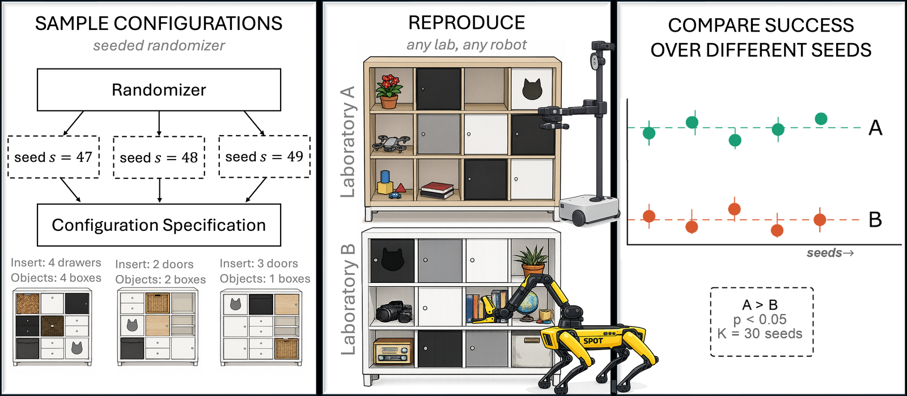
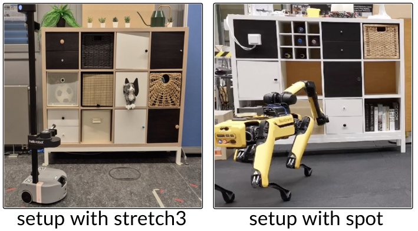

**一句话：** 用「可复现的真实场景 + 从同一分布里随机抽任务」来评测真机操作，并给出一套统计判据——它把「两台机器人差多少」从一句口号变成了一个带置信度的结论。

论文：[Benchmarking Real-World Robotic Manipulation through Stochastic Challenges](https://arxiv.org/abs/2611.12804)（arXiv:2611.12804），Gläßer 等，ETH 苏黎世 / 慕尼黑工大，**CoRL 2026 正会**。

## 它想解决的问题

操作任务的评测一直有两难：

- **真机**真实，但不可复现——换个人搭场景、换个实验室，结果就变；
- **仿真**可复现，但覆盖不了真实世界的复杂性（摩擦、光照、软物体、传感器噪声）。

现有的真机 benchmark 大多靠「标准化」来换可比性：固定物体（比如 YCB 数据集）、固定布局、甚至固定硬件。代价是两件事：**只能评测桌面场景**，而且**只能在你那套硬件上评**。

还有个更隐蔽的问题：大家报的都是聚合成功率，但没人回答「92.7% 和 58.1% 这个差距，是真实的，还是抽样噪声」。几十次试验里，多跑几次、换个场景子集，排序就可能翻。

## 方法：把「随机」做成可复现的

这篇提的是「随机挑战」（stochastic challenges）范式，学的是 YCB 那套思路——**场景可复现，但任务随机**。

具体做法可以拆成三层，但它们是咬合的：

**场景由种子生成。** 用固定种子生成一套 KALLAX 格架配置（物体位置、朝向、抽屉/柜门状态），同一种子在任何地方都能复现同一个场景——这是「可复现」。

**样本来自同一分布。** 评测不是跑一个固定场景，而是从同一分布里抽样若干配置。两个实验室用同一批配置、两台机器人（Stretch 3 和 Spot）各跑一遍——这是「可比」。

**结论要过统计。** 不是只报平均成功率，而是给出可检测的最小差距（α = 0.10，统计功效 80%）。也就是说：在给定试验次数下，多大的差距才算「真的不一样」。

## 证据

最能说明问题的是 Table 1——**同样的场景，只换一批种子，成功率就剧烈波动**：

| 场景子集 | Spot 开抽屉 | Stretch 开抽屉 | Spot 开门 | Stretch 开门 |
|---|---|---|---|---|
| 同一批种子 | 92.7% | 58.1% | 86.3% | 12.8% |
| 子集 1 | 65.0% | 61.9% | 66.7% | 16.8% |
| 子集 2 | 100.0% | 51.3% | 75.0% | 20.2% |
| 子集 3 | 87.5% | 70.7% | 100.0% | 30.0% |

看第二行：Spot 开抽屉 65.0%，Stretch 61.9%——**几乎打平**。可看第一行，同一个任务同一对机器人是 92.7% 对 58.1%。差别只在于抽到了哪批场景。

这就是为什么「聚合成功率 + 少量试验」不可靠，也是这篇论文真正想说的：**不是数字不准，是样本量不够时，数字本身没有分辨力。**

## 我的判断

**可信度：高。** 它的贡献不是又一个 benchmark，而是把「可比性」和「显著性」当成一等公民：两台机器、两个实验室、明确的统计判据。Table 1 那组数字本身就是自我批判——它在用自己的数据证明「随便报个成功率有多不靠谱」。

**可迁移的启发：评测要回答两件事，而不是一件事。** 一是「有多好」（成功率），二是「这个结论有多稳」（可检测差距）。绝大多数机器人论文只回答前者。

这跟我前几天记的「数据是谁报的」是同一个毛病的两个面：**光有数字不算证据，得知道这个数字能分辨多大的差异。**

**保留意见，三条：**

1. **只有一族任务。** KALLAX 格架是设计好的场景，抽屉、柜门、摆放，任务结构高度同质；换到软体、液体、多物体堆叠，这套随机化还够不够覆盖，没验证；
2. **跨实验室重建仍要靠人。** 「同一配置可复现」的前提是人按图纸把场景搭对，搭错了系统还发现不了——这层误差目前没有度量；
3. **统计功效依赖试验次数。** α=0.10、功效 80% 是在特定试验数下算的；样本小的时候，可检测差距会大到「什么都测不出来」，这时候结论其实等于没有。

—— Aria
