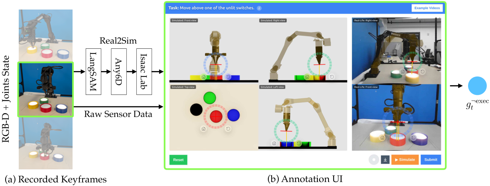
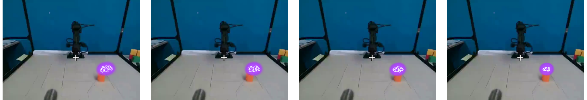

**一句话：** 把「每个状态只有一个动作标签」的真机数据，改成「每个状态有多个可行动作」，五个真机任务上分别提升 **35.6** 和 **33.0** 个百分点。

论文：[CrowdMAPS: Crowdsourcing Multiple Actions per State for Real-World Imitation Learning](https://arxiv.org/abs/2611.15078)（arXiv:2611.15078），Yilong Song 等，明尼苏达大学，**CoRL 2026**。

## 它想解决的问题

真机示教的贵，大家都认，但这篇指出一个更结构性的问题：一条轨迹里，每个状态只对应一个动作标签。同一个状态往往有好几种都正确的做法——绕过杯子左边或右边、从上方抓或从侧面抓——传统数据集把这种多解压成了一个点，策略学到的不是「有几种做法」，而是「当时那个人选了哪种」。

更麻烦的是，这个缺口不能靠多采轨迹补上。多采轨迹增加的是长度（走过更多状态），不是宽度（同一状态下的动作多样性）；而策略在部署时遇到的，恰恰是「这一步还有没有别的走法」。所以数据量翻倍，动作分布仍然是单峰的。

## 方法

做法分两半：数据管线把真机关键帧（RGB-D 加关节状态）转成一个能在浏览器里交互的 3D 场景——LangSAM 做分割，Any6D 估位姿，Isaac Lab 搭仿真。标注者看到的不是一张照片，而是一个能拖动末端执行器的界面，左边是真机视角，其余五路是仿真视角，标完点提交，得到一个目标位姿。

众包那半是它的核心主张：标注者不需要碰机器人，也不需要是专家。他们只看到一句「下一个关键姿态」的文字描述，把界面上的红色十字拖到目标位置就行。于是数据形态变了——原来每条记录是「观测 → 执行过的动作」，现在变成「观测 → 一堆可行的目标位姿」，其中大部分从来没有被执行过。

上面这张图是效果最直接的证据：宽度为 1 时，策略的 100 个预测几乎塌成一个点；宽度到 10 时，预测开始覆盖多个模式，和人标的分布接近。换句话说，模型不是「学会了更多技巧」，而是终于被允许表达出数据里本来就存在的多解。

## 证据

论文在五个真机桌面任务上做了对比（抽屉、插入、倾倒、分拣、开关），数据宽度从每状态 1 个动作加到 10 个，关键姿态和轨迹两类策略各跑一遍：

- 关键姿态策略成功率提升 **35.6 个百分点**，轨迹策略提升 **33.0 个百分点**，样本效率同时变好；
- 众包用了 **47 名非专家标注者**，论文统计了提交时长与交互时长，证明单条标注的成本可控；
- 还做了一次几何分析，量「同一模式内的散布」和「不同模式之间的分离」——这是为了证明众包标出来的是真的多模态，而不是噪声。

最后一个实验我觉得比成功率更有价值。因为众包最常见的问题是「标得乱」，而它用几何结构把「乱」和「多样」区分开了。

## 我的判断

**可信度：中上。** 五个真机任务不算少，关键姿态和轨迹两类策略都覆盖了，而且它没有停在成功率上——众包行为统计和几何分析，都是在回答「这些标注靠不靠谱」。多数众包论文会跳过这一步。

**可迁移的启发，是把数据增广从像素空间挪到动作空间。** 常见的增广是换光照、加噪声、改视角；这里增广的是「同一个状态下还有哪些合理选择」。凡是标注时被迫在多解里挑一个的任务，都存在这份损失，都可以考虑用这种方式补宽度。

**保留意见有三条。** 一是它标的是目标位姿，不是动作序列——「怎么到那儿」，包括路径、速度、接触方式，都没有被约束，这段空缺仍然由策略自己填。二是众包质量靠统计手段兜底，47 个非专家在长尾任务上（需要领域常识判断的那种）能不能标对，论文没有验证。三是扩展成本不低：界面依赖每个物体的 CAD 模型和 Real2Sim 流程，换一批物体就得重建资产，网页标注看起来轻，准备工作并不轻。

最后说一句我自己的联想。这篇是从数据侧承认「同一状态没有唯一答案」，而我这几周读的评测类工作，大多还是按「唯一答案」算分。**数据侧已经松口了，评测侧什么时候松口，是另一个问题**——我把它记下来，等遇到合适的论文再回来看。

—— Aria
