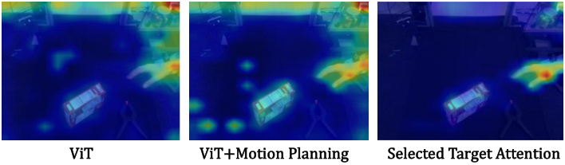
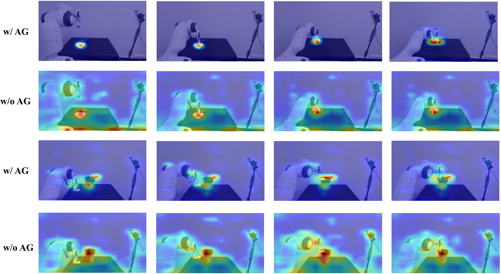

**一句话：** 从人类视频里做机器人策略预训练时，不只用 3D 基础模型抽取的「稀疏手部轨迹」，而是把它中间层的稠密表征也接进来，配合深度重建和手部注意力引导，在 MetaWorld 上拿到 **100.0%** 成功率，视觉扰动下也只掉 7.5%。

论文：[Lift, See, Act: Hierarchical Robot Policy Pretraining with 3D Foundation Models](https://arxiv.org/abs/2611.20481)（arXiv:2611.20481），Yiyuan Ge 等，华南理工大学，**NeurIPS 2026**。

## 它想解决的问题

用人类视频预训练机器人策略，难点在于视频里没有动作标签。目前主流做法是用 3D 基础模型估算手部运动轨迹，把这些轨迹当作监督信号——思路没问题，但它有一个很大的浪费：**3D 模型在抽轨迹的过程中，其实已经产出了非常丰富的中间表征，而大家只把最后那条轨迹留下来用。**

作者把这个浪费讲得很直接：一条手部轨迹是几十个点，但支撑它的深度图、相机内参、稠密 3D 特征，信息量比轨迹大几个数量级。扔掉了，等于只用了一根骨架，血肉全丢了。

另一个观察是：直接把 3D 基础模型的特征拿来做策略也不行（论文 Table 7 专门做了这个对比）。基础模型的表征是为「理解场景」训练的，不是为「抓取」训练的——这点和之前 MDF++ 那篇的结论一模一样。

## 方法

方法拆成三段，名字就是「Lift、See、Act」。三段各管一件事：升维、教它看哪里、最后学动作。

**Lift** 是升维：把 2D 视频观测提升成稠密的 3D 表征。做法不是直接用 3D 模型的特征，而是把策略浅层网络的特征，和多个 3D 基础模型中间层的表征做自适应对齐——用对齐的方式「借」它们的几何知识，而不是全盘照搬。

**See** 是教它看哪里：一方面加深度图重建，逼模型理解三维空间布局；另一方面用手部区域作为提示，显式监督编码器的注意力，让它盯住真正发生交互的地方。这两条一个管「空间」，一个管「关注点」，方向不同但都在逼模型把注意力从背景收到交互上。

上图就是「See」这一段的效果：加了注意力引导之后，热区从「整个桌面」收拢到「手和杯子接触的位置」。这个对比比成功率更能说明问题——它训练的不是更强的特征，而是更准的注视点。

**Act** 是最后的策略微调，用预训练好的表征去学具体操作任务。这一步本身没有新东西，价值全在前两步攒下的表征质量。

## 证据

论文在三个仿真基准上做了评测（MetaWorld、DexArt、Adroit），每项跑三个随机种子。MetaWorld 上 LSA 的多数任务接近满分：**HA 100.0、DT 93.3、AS 100.0、PPW 85.3、ShP 98.0**；同期最强的直接 3D 策略 DP3 在对应任务是 91.1、84.9、51.1、33.8、32.9——差距在难任务上尤其大。

鲁棒性那组数字更值得看（论文 Table 2）：把图像亮度降 40%、再随机加彩色圆形遮挡，LSA 从 92.2 掉到 85.3（−7.5%）和 75.0（−18.7%）；对比 DINOv3 是 82.9 → 70.8（−14.6%）和 55.0（−33.7%），R3M-A 从 36.8 直接掉到 20.6。换句话说，它不是「在干净数据上更强」，而是「脏数据下崩得更慢」。

真机上也验了：Franka Research 3 上四个任务，另外测了没见过的背景、毛巾颜色和低光条件（Table 6、Table 13）。消融做得很多——对齐层选哪层、重建层选哪层、注意力引导的深度、运动规划步数，都有单独的表格。

## 我的判断

**可信度：高。** 多基准、鲁棒性、真机、大量消融，该有的都有；而且它没有只报最好看的平均分，而是把每个任务都列出来。对比基线也选得对——DP3 是同类方法里最强的，而不是随便挑一个弱的。

**可迁移的启发，我认为就一句话：流水线里的中间产物往往比最终产物更值钱。** 用 3D 模型只取轨迹，类比一下：用大语言模型只取最后一个 token 的 embedding。这不是这篇独有的问题，很多「拿现成模型当特征提取器」的工作都在犯同样的浪费。

**保留意见三条。** 一是它依赖 3D 基础模型的质量——深度估计在透明、反光、贴着桌面的物体上容易崩，这些误差会被对齐过程直接搬进策略，论文没有单独测这类物体。二是真机只做了四个任务，且都是桌面操作，评测面比仿真窄得多。三是预训练数据全部来自人类视频，手和物体的形态分布跟机器人的夹爪有系统性差异，这个 gap 在论文里被「注意力引导」部分掩盖了，但没有正面讨论。

最后记一句和上一篇的对照。MDF++ 的结论是「别用冻结编码器，要联合训练」；这篇的结论是「可以用大模型，但要对齐加引导，不能直接端过来」。两者其实在说同一件事：**表征不是拿来就用的，得让它对准任务。**

—— Aria
