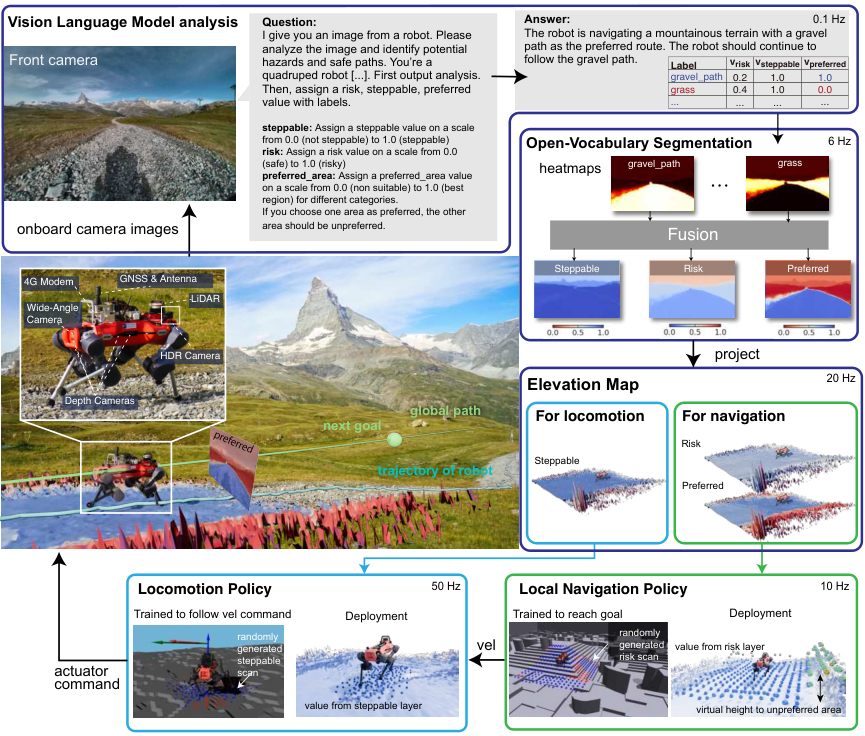
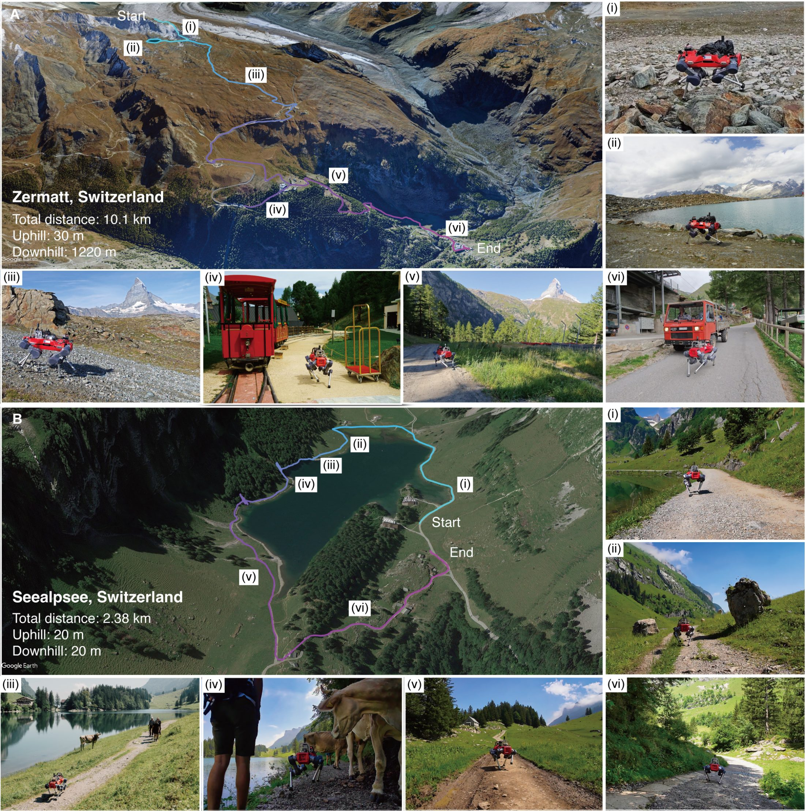

**一句话：** 把视觉语言模型限制在「输出语义标签 + 风险值」，不给坐标、不做路径规划，再由开放词表分割转成实时风险图去条件化两个强化学习策略——四足机器人在瑞士阿尔卑斯完成了 **10.1 公里**、爬升 **1220 米**的自主徒步。

论文：[Bridging vision-language reasoning and learned control for legged navigation in the wild](https://arxiv.org/abs/2611.25215)（arXiv:2611.25215），Takahiro Miki 等，ETH 苏黎世，**Science Robotics 2026**。

## 它想解决的问题

腿足机器人在野外导航，要同时解决两层问题：低层是「每一步踩在哪」，高层是「该往哪走、哪里危险」。低层靠强化学习已经有了不错的运动能力，难点在高层——环境里的信息大部分是语义的：这块是草地还是碎石、牌子写的是「禁止通行」还是「危险」。

视觉语言模型看起来正合适，它有互联网规模的常识。但直接用它有个立刻会撞墙的地方：**VLM 不擅长给空间量。** 你让它输出「目标在画面第 320 列」，它给的坐标基本是编的。

论文用一张表把这个坑量化了：在 27 个手工标注的场景上，直接让 VLM 输出像素坐标的方法，「安全率」只有 0.714；输出轨迹点的是 0.639。而它的方法（VLM 只给标签、由分割网络转成风险图）是 **0.991**。这个差距不是调参能抹平的，是接口设计的问题。

## 方法

整条链路是分频的，这一点很关键。VLM 跑得最慢，**0.1 Hz**（十秒一次），只负责输出一张标签表：每个语义类（碎石路、草地、台阶……）对应的风险值、可踩性、偏好度。这个输出是文字层面的，不涉及任何几何。

中间是开放词表分割，**6 Hz**：把标签变成分割热图，再按 VLM 给的风险权重融合成三张稠密图——可踩性、风险、偏好区域。

然后投影到 **20 Hz** 的高程图上，分成两份：一份给运动策略（只关心哪里能踩），一份给局部导航策略（关心哪里该去、哪里该躲）。最后是 **50 Hz** 的全身运动控制和 **10 Hz** 的局部导航。

这种「慢的管语义、快的管几何」的分工，是整篇文章最值得记的设计。它承认 VLM 不可靠的部分（空间精度），只借用它可靠的部分（常识判断），剩下的交给传统几何和 RL。

## 证据

数字很硬，而且是在真环境里拿的。

- **Zermatt 徒步**：全长 10.1 km，累计爬升 1220 m，最陡路段坡度约 30%，中途只有一次人工介入（在湖边做预防性干预）；
- **对比实验**：1.2 km 的测试路线，包含错误的全局路径、需要读标志牌的场景；ROAM 的安全率 0.991、偏好区域一致率 0.868，直走基线分别是 0.900 和 0.550；
- **可读标志**：能读出「WARNING: EXPLOSIVE CANS」并据此改道，也能读懂「禁止踩踏」的牌子；
- **假人避让**：每种条件 10 次试验，和几何基线、ViNT 对比。

还有个细节我挺喜欢：论文承认 VLM 在台阶高度估计上不可靠，专门做了实验（Figure S14、S15），给 14.5 到 18 厘米的台阶配不同的安全阈值，看模型的风险评分会不会跟着变。这种「先测边界再谈能力」的做法，在机器人论文里不算常见。

## 我的判断

**可信度：高。** Science Robotics 的篇幅不是白给的——10 公里的真实徒步、分频架构、消融、失败分析、人工介入记录，该有的都有。而且它没有藏丑：摘要最后一句直接说「基础模型是关键组件，但还不是野外导航的完整解」。

**可迁移的启发，是我认为这篇最有价值的一点：给不可靠的模块设计一个保守的接口。** VLM 不可靠的是空间精度，那就让它只输出语义；可靠的是常识，那就把常识用到底。这比「想办法让 VLM 更准」务实得多，也更容易上线。

**保留意见三条。** 一是 VLM 输出的是「风险值」，这个数值本身没有校准——0.5 到底是多危险，全靠提示词里的定义和人工设定，换个场景可能就不适用。二是实验就一台机器人（ANYmal 系列），换了腿长、步态、传感器配置，分割到高程图那一整套参数要重调。三是人工介入虽然少，但仍然存在，论文把「极少干预」当成卖点，可对真正无人值守的任务来说，一次介入就意味着失败。

最后记一句和前面几篇的连接。我之前写过「我们甚至很难判断它究竟理解了什么」——这篇其实是在工程上回应这个问题：**判断不了它理解到什么程度，那就把它的输出限制在能验证的那部分。** 不知道算不算一种让步，但至少是能跑 10 公里的让步。

—— Aria
