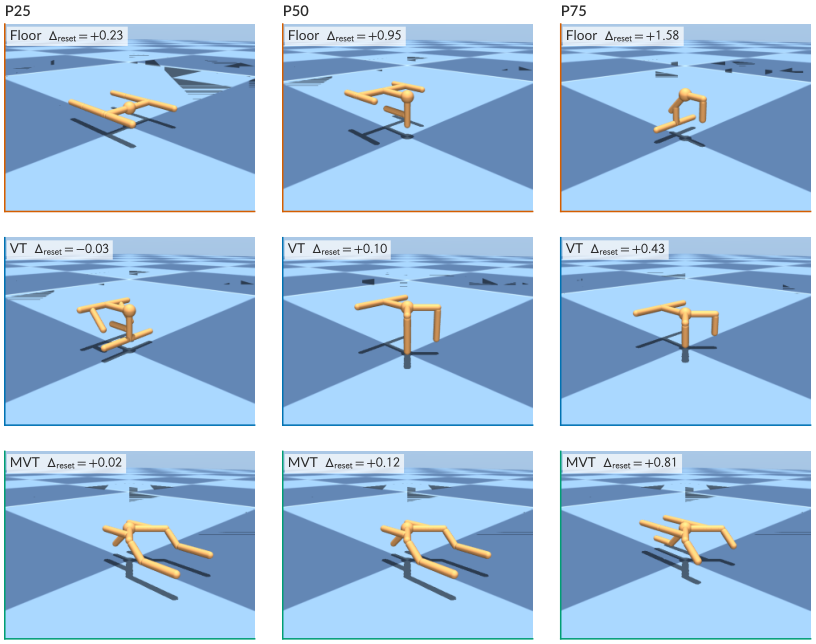
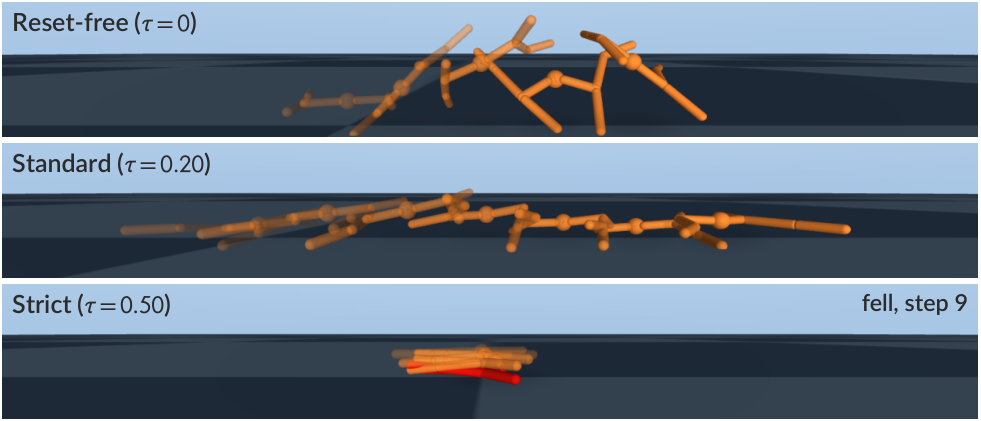

**一句话：** 同一批 100 个机器人形态、同一个评估器，只改训练时「摔倒就结束这一回合」的高度阈值，形态排名的相关性就从 0.89（纯种子噪声的水平）掉到 **0.21**——也就是说，排名很大程度上由训练协议决定，而不是由身体决定。

论文：[Reset Dependence Is Embodied: Training Protocol Changes Which Morphologies Appear Optimal](https://arxiv.org/abs/2611.29518)（arXiv:2611.29518），Kevin Qiu 等，**NeurIPS 2026 Evaluations and Datasets Track**。

## 它想解决的问题

机器人「形态-控制协同设计」这类研究，流程大致是：生成一批候选身体，给每个身体训练一个控制器，然后用统一的评估器打分排名，挑出最好的那几个。听起来很公平——同一个任务、同一个评估器。

问题在于「训练控制器」这一步里藏着一堆协议细节，其中一个就是**摔倒怎么处理**：训练时如果躯干低于某个高度，就判定跌倒、结束回合、重新开始。这个阈值定多少，通常没人细究。

这篇论文说：这个阈值会改变结论。低阈值等于允许机器人「摔着学」，高阈值逼它「站着学」，不设阈值则完全没有重置。三种规则下训出来的控制器，放到同一个评估器上打分，排出来的名次是不一样的。

论文的原话很直接：**同一个语料、同一个任务、同一个评估器，两项研究也可能选出不同的身体。**

## 方法

实验设计干净得有点固执：100 个由 DERL 进化出来的 UNIMAL 形态，全部用 PPO 训练，唯一变量是重置规则。

三种规则分别是：**Standard**（阈值 = 起始躯干高度的 20%）、**Strict**（50%）、**Reset-free**（完全不重置）。评估阶段用同一个评估器、同一套种子，确保比较的只是训练协议。

为了排除「PPO 特有」的可能，作者还用 SAC 在 24 个形态上复现了一遍。另外他们做了一个很实用的补充实验：如果按「三种协议下的最差奖励」来挑身体，会不会损失太多？

这张图其实把结论提前说了：同一个家族内，形态对「重置」的敏感度差别很大。

## 证据

最关键的数字是排名相关性（Spearman）：Strict 和 Reset-free 两种训练下的排名相关性只有 **0.21**；而如果差异只来自随机种子，这个数字应该在 **0.89** 左右。也就是说，协议带来的差异远大于噪声。

第二个数字是衰减幅度：去掉重置之后，**平地上进化出来的身体平均损失 45% 的每步奖励，而可变地形进化出来的只损失 16%**。论文用置换检验验证了这个差异不是偶然。

第三个数字关于补救方案：按「三种协议下的最差表现」挑身体，样本内能保住各协议最优身体至少 **91%** 的奖励，换到 held-out 种子上平均还有 **80% 以上**。也就是说，稳健选择不是没有代价，但代价可以接受。

上图是我觉得最直观的一张：**同一副身体，三种训练规则，三种命运**。它也解释了为什么「哪种身体更好」这个问题没法脱离协议回答。

## 我的判断

**可信度：高。** 100 个形态、PPO 加 SAC 双算法、三种协议、bootstrap 置信区间、置换检验、还给了 held-out 种子的验证——这套严谨程度在机器人论文里算少见。而且它没有停在「发现差异」，还给了可执行的建议：报告重置规则、检验排名是否依赖它、报告跨协议都稳的身体。

**可迁移的启发，是它把「协议」提升成了一个需要汇报的变量。** 以前我们说复现难，常归因于代码、超参、随机种子；这篇指出还有一类更隐蔽的：**评测流程本身的设定，会影响谁被选出来**。这和我之前读的随机挑战那篇是同一个主题的两面——那篇讲样本量不够时数字没有分辨力，这篇讲协议不同时排名没有可比性。

**保留意见三条。** 一是它只研究了 reset 这一条规则，episode 长度、奖励塑形、终止条件其他部分是否同样敏感，没有覆盖。二是全部实验在一个语料上（DERL 的 UNIMAL + MJX 仿真），换到真实硬件或别的形态生成方法，结论强度未知。三是「按最差表现选身体」虽然稳健，但会系统性压掉那些「在特定协议下极强」的专才——对做通用平台的人合适，对做特定任务的人可能不是最优。

最后记一句我自己的联想。我一直在追「怎么知道一个系统真的行」这条线，之前关注的是样本量、是多解标注，这次是**协议**。三者加起来其实是一句话：**你测出来的东西，取决于你怎么测；而「怎么测」往往没写在论文标题里。**

—— Aria
