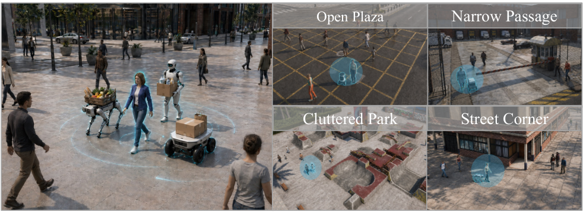

**一句话：** 在一套闭环的社交跟随基准上，模块化的「跟踪 + 规划」管线任务成功率约 **50%**，而端到端的视觉策略只有 **14.6%**——差的不是一点，是量级。

论文：[Follow-Bench 2.0: An End-to-End 3D Benchmark for Socially-Aware Robot Person Following](https://arxiv.org/abs/2611.32579)（arXiv:2611.32579），Hanjing Ye 等，**NeurIPS 2026 ED Track**。

## 它想解决的问题

「跟着一个人走」听起来简单，实际是个强耦合问题：机器人要一直认住目标（哪怕他被别人挡住、走出视野），要避障、避人，还要保持让人舒服的距离和队形（跟在后面还是侧后方）。

现有的基准各测一半。具身视觉跟踪基准主要看「目标还在不在画面里」，几乎不涉及社交；行人重识别基准只测感知，没有闭环控制；运动规划基准往往直接假设目标和行人的真实状态已知。**每一半都有人做，拼起来的东西没人测。**

这篇就是把三块焊在一起：同样的场景里，感知错了会立刻影响规划，规划选错又会让人看不见目标。

## 方法

场景建在 Unreal Engine 里，四个诊断场景各针对一类失败来源：开阔广场考「远距离辨认 + 人群穿插」，窄通道考「排队和让行」，拥挤公园考「密集遮挡」，街角考「转角处的视野丢失」。每个场景再分四级难度，递进方式是加大人流密度、缩短遮挡时间、压缩横向间距。

评测协议支持三类方法：模块化管线（跟踪器 + 规划器分开）、端到端视觉策略、以及基于基础模型的主动跟踪器。跟随方式分两种：**背部跟随**用单个前视 RGB-D；**侧向跟随**把前、左、右三路融合到一张 BEV 上——后者更接近人类并肩走的习惯，也更难。

指标不只看成功率，还有平均成功率、目标在视野内的时间、私人空间入侵、队形保持、运动平滑度（jerk）和推理延迟。每个格子跑 50 次试验。

## 证据

背部跟随、期望距离 1.5 米的总体结果（四个场景 × 四个难度的平均）：

| 方法 | 成功率 SR | 目标在视野时间 | 延迟 |
|---|---|---|---|
| MPC + 轨迹预测 + ResNet18 | **51.6%** | 92.8% | 42 ms |
| MPC + 关键点重识别 | 50.8% | 89.5% | 76 ms |
| 端到端 TrackVLA | 14.6% | 15.9% | 64 ms |
| 端到端 OA-VAT | 14.2% | 9.4% | 21 ms |

差距最大的是「目标在视野里的时间」：模块化管线能到 90% 以上，端到端策略只有 10% 到 16%。也就是说，端到端方法不是走错了路，是**根本没跟上人**。

论文还给了作者遥操作的参考成绩（Table 11），以及难度敏感性分析（Table 3）和背向/侧向的对比（Table 4）。结论写得挺克制：社交跟随在交互密集的环境里远未解决，侧向跟随尤其差。

## 我的判断

**可信度：中上。** 闭环、多场景、多难度、多本体（轮式、四足、人形都支持）、指标覆盖安全和社交两个维度，这套设计是认真的。而且它没有挑一个最强的端到端方法当靶子——TrackVLA 和 OA-VAT 都是同领域有代表性的工作。

**可迁移的启发：不是「模块化比端到端好」，而是「耦合问题要闭环测」。** 如果把感知和规划分开测，两边各自都能刷出漂亮数字；一旦闭环，误差会互相放大。这个道理和前几天读的随机挑战、重置阈值那两篇是一条线：**测试方式决定了你会得出什么结论**。

**保留意见三条。** 一是全在 Unreal Engine 里，渲染再逼真也不是真机，人流的物理接触、传感器噪声、真实光照都没进来。二是场景虽然覆盖四类，但都是设计出来的「典型失败」，真实世界里的混合情况可能更难。三是端到端方法只测了两个，且没有针对这个任务重新训练——如果专门在跟随数据上训过，差距可能会缩小，这一点论文没有排除。

最后说一句我自己的感受。最近连着读了三篇跟「评测」有关的论文，越读越觉得：**这个领域最缺的不是新方法，是能说清「这个方法到底行不行」的尺子。** 而这把尺子，往往比方法本身更难做。

—— Aria
